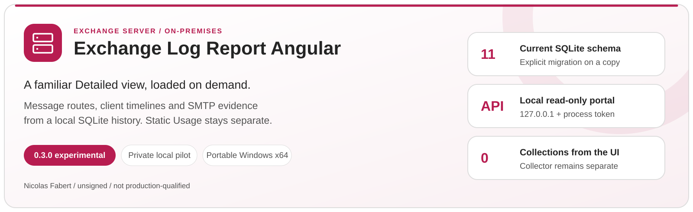
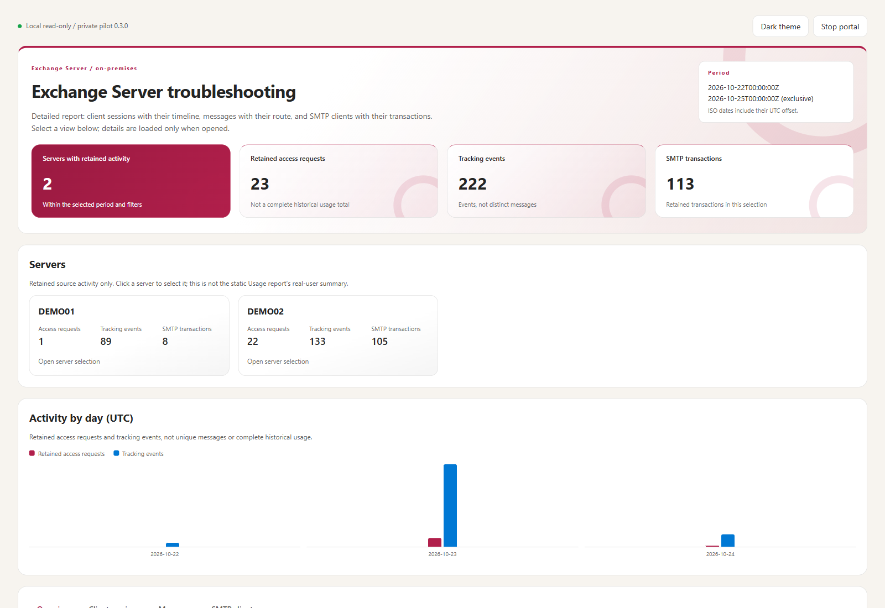
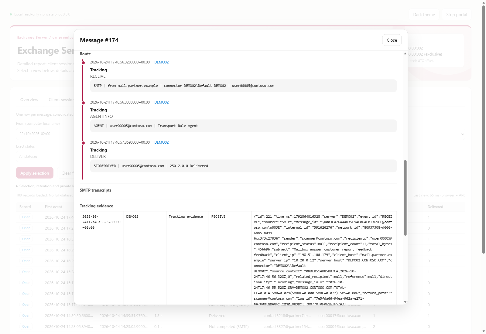

<p align="center">
  <picture>
    <source media="(prefers-color-scheme: dark)" srcset="docs/images/readme-banner-dark.svg">
    
  </picture>
</p>

<p align="center">
  <a href="#why"><b>Why</b></a> &nbsp;&middot;&nbsp;
  <a href="#how-it-works"><b>How it works</b></a> &nbsp;&middot;&nbsp;
  <a href="#reports"><b>Reports</b></a> &nbsp;&middot;&nbsp;
  <a href="#quick-start"><b>Quick start</b></a> &nbsp;&middot;&nbsp;
  <a href="collector/README.md"><b>Runtime guide</b></a> &nbsp;&middot;&nbsp;
  <a href="collector/docs/Serve-Guide.txt"><b>Serve guide</b></a>
</p>

**Author:** Nicolas Fabert<br>
**Version:** 0.3.0 - experimental and unreleased; public repository preparation.

This is a parallel development project, not a replacement for an existing
ExchangeLogReport deployment. No official release, hosted CI success or production
qualification is established by this source tree. The five shipped PowerShell
scripts carry Nicolas Fabert Authenticode signatures and RFC3161 timestamps.
Those signatures do not authenticate the C# sources, compiled Angular assets,
native binaries or mutable operator configuration; see [PROVENANCE.md](PROVENANCE.md).
Respect downloaded-file and application-control policies; do not bypass them.
Dependency maintenance and validation status are documented under [Tests](#tests).

## Why

The historical Detailed report creates a static investigation snapshot. This pilot
keeps its familiar presentation while loading **only the requested page or detail**:
client sessions, message routes, SMTP client groups and individual conversations.
It is intended for local troubleshooting of Exchange Server SE on-premises logs.

The original collector workflow and the **static Usage HTML/CSV deliverable remain
separate**. A faster first page is not proof of faster collection, a smaller database
or complete historical coverage. Keep the original deployment and databases intact.

## How it works

1. Explicit collector commands read designated Exchange log folders and remove the
   configured noise before writing a local SQLite history. Discovery is separate.
2. Schema 11 adds exact-text dictionaries, message rollups and SMTP client buckets.
   These structures trade collection work and storage for bounded on-demand reads.
3. Serve uses the collector's `HttpListener` on **127.0.0.1 only**, with a per-process
   access token, separate read-only SQLite connections and bounded requests.
4. Angular assets are compiled into the portable package. No Node.js, IIS, CDN or
   externally hosted frontend is needed by an administrator.

The operational sequence is **configure/discover once → collect on a schedule →
commit SQLite data → consult or export deliberately**. Static Usage/Detailed
reports and Angular read the collected history independently. Opening Angular
does not trigger collection or build a static report. To see later collection
results, update the selected end time and click **Apply selection**; the portal
does not continuously refresh a fixed time window.

Serve does not collect, send report mail, migrate a database or change Exchange
configuration. Existing collector mail functions remain explicit and disabled in
the example configuration. Never share a launch token or readiness file.

Message hashes are lookup accelerators, never identities: exact Message-ID text
comparison remains mandatory. Serve rejects an incompatible or unreconciled schema
instead of silently migrating it or returning an empty success.

## Reports

| View | What it provides |
|---|---|
| Overview | Hour/server activity from retained rows, server cards and daily activity |
| Client sessions | Bounded session pages and an on-demand cross-server timeline |
| Messages | Consolidated messages, route steps and selected SMTP evidence |
| SMTP clients | Peer/account groups, scoped transaction pages and individual transcripts |
| Usage HTML/CSV | The separate static usage report produced by the collector |
| Legacy Detailed | Retained compatibility exporter; not generated by portal startup |

<table>
  <tr>
    <td width="50%" valign="top"><a href="docs/images/angular-overview.png"></a><br><sub><b>Overview</b> &middot; actual local rendering with generated demonstration logs only.</sub></td>
    <td width="50%" valign="top"><a href="docs/images/angular-message-route.png"></a><br><sub><b>Message detail</b> &middot; route and source evidence loaded when opened; no client data.</sub></td>
  </tr>
</table>

Retained request counts are not complete usage totals; hourly distinct-message
counts cannot be added into a globally distinct total. HTML row caps, visible
pages and complete CSV exports are different boundaries.

Noise removal is **not anonymisation**. Real databases and reports can contain
identities, IP addresses, subjects, device identifiers and SMTP transcripts.
Restrict access to local files and exported downloads. Database retention does not
remove exported reports or copies sent by mail.

## Requirements

| Context | Requirements |
|---|---|
| Portable Windows x64 package | Supported desktop browser, writable restricted local folder and normal Windows application-control approval |
| Collection/discovery | Existing Exchange and Windows log-access permissions; Windows PowerShell 5.1 and Exchange management prerequisites where discovery requires them |
| Development | Node 24 satisfying `frontend/package.json`, npm, PowerShell 7.4+, .NET SDK supporting the current .NET 8 host, existing Pester 6.1.0 |
| Database | Schema 11 for Serve, or an explicitly migrated **new copy** of a supported older database |

The package bundles portable PowerShell and the storage runtime. Its local integrity
manifests are unsigned: matching hashes alone do not authenticate a publisher.
Read [SECURITY.md](SECURITY.md) and [PROVENANCE.md](PROVENANCE.md).
Plan the .NET 8 host upgrade before its November 10, 2026 end of support.

## Quick start

Use a reviewed **complete portable package**, not an old package mixed with current
source files. Edit `collector\config\ExchangeLogReport.config.psd1` for the designated
test servers. From the extracted package root:

```bat
Run-Collector.cmd -Mode Status
Run-Collector.cmd -Mode Discover
Run-Collector.cmd -Mode Collect
Start-ExchangeLogReportAngular.cmd
```

Discovery and collection access the configured log sources: run them only when
intended. To inspect an already prepared database copy without either operation:

```bat
Start-ExchangeLogReportAngular.cmd -DatabasePath "D:\Review\ExchangeLogReport.sqlite"
```

Generate the separate static Usage report with:

```bat
Run-Collector.cmd -Mode Report -ReportType Usage -Range Last7Days -NoCollect
```

Serve never migrates the source. Use the explicit new-copy storage procedure in
[README.txt](README.txt) for an older schema. A live WAL database needs a consistent
SQLite backup, not a copy of its main file alone. Never point the original legacy
collector at an optimized Angular-profile database.

Build from this source tree using the existing procedure:

```text
cd frontend
npm ci --no-fund
cd ..
pwsh -NoProfile -File .\tools\Build-Standalone.ps1 -OutputRoot <new-absolute-local-artifacts-folder>
```

The builder rejects an existing destination and includes no development databases,
source logs or credentials. A successful build does not waive an unsuccessful
dependency audit or authorize distribution.

## Documentation

| Document | Scope |
|---|---|
| [Runtime README](collector/README.md) | Portable requirements, launchers, layout and data handling |
| [Runtime quick start](README.txt) | Storage diagnostics, copy/migration procedures and measured limitations |
| [Serve guide](collector/docs/Serve-Guide.txt) | Current Angular behavior, collection/consultation sequence, schema, bounds and automation |
| [User guide: Angular workflow](collector/docs/ExchangeLogReport-UserGuide.html#c-angular-investigation) | Step-by-step launch, filters, sessions, message routes, SMTP, exports and freshness, alongside Usage and Detailed |
| [Developer guide: Angular Serve](collector/docs/ExchangeLogReport-Guide.html#angular-serve) | Collection-to-SQLite-to-API lifecycle, concurrent reads, component boundaries and operational diagnostics |
| [Changelog](CHANGELOG.md) | Experimental schema and performance work, with its limits |
| [Provenance](PROVENANCE.md) | Build inputs, dependency overrides, manifest scope and publication gates |

The HTML collector guides retain historical context; their old measurements are
not current capacity guarantees. The delivered runtime README and Serve guide
govern the Angular package's paths and startup. Local versus off-machine recovery,
publisher signing, live repository protections and actual-release ZIP attestation
remain separate requirements.

## Tests

Use the existing Angular build and one-shot test commands from `frontend`:

```text
npm run build
npm test -- --watch=false
npm audit --audit-level=high
```

The proposed CI runs the collector, schema/migration, Serve, integrity and workflow
Pester suites using the **freshly packaged configured PowerShell runtime**.
Its existing entrypoint is `.github\scripts\Invoke-CITests.ps1 -PackageRoot <package>`.
See [README.txt](README.txt) for individual local commands. Synthetic fixtures and
test working directories are not shipped.

The October 26, 2026 maintenance resolves the former **4 high and 7 moderate**
npm entries: the full audit now reports **zero vulnerabilities**. Parent-scoped
overrides pin Express 5.3.0's `body-parser` to 2.4.0 and AJV 8.18.0's `fast-uri`
to 3.1.9. Both satisfy their parents' declared ranges; Angular runtime remains
21.2.25. No major/prerelease upgrade, audit suppression or forced fix is used.

Restricted development-network access required an owner-authorized acquisition
host. The unchanged official npm archives were verified against registry
SHA-512 integrity metadata, rechecked after transfer and added to the normal npm
cache before `npm ci`. The lockfile retains official registry archive URLs and
integrities, not local file paths or substituted Git sources. Acquisition files
and helper-host state are not shipped.

This resolves the dependency findings, not the development network's mirror/TLS
availability. A fresh environment still needs approved access to its exact
locked packages. No registry, DNS, TLS-verification setting or audit threshold
was weakened or changed. A clean npm audit does not prove the native/runtime
package is vulnerability-free or waive separate publication requirements.

Local tests, source inspection and synthetic measurements do not establish
production-scale equivalence, OS-cold-cache latency or a successful hosted run.
Do not weaken existing tests or add unestablished required checks to publish.

## License

This experimental pilot does not contain a project licence granting redistribution
rights. The owner must establish that grant before distribution; this README does
not invent one. Bundled components retain their own licences:
[collector notices](collector/THIRD-PARTY-NOTICES.md) and
[SQLite tools notice](lib/sqlite-tools/NOTICE.txt). The built package also includes
the Angular third-party licence inventory.

## Disclaimer

This Script is a Personal project.
It's provided "AS-IS". It's not an official Microsoft product so no support can be expected from Microsoft.

As any scripts you must read carefully the documentation and test it first in a Test environment before any run in Production.
